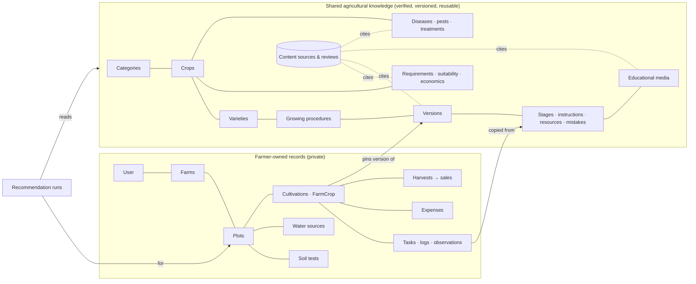

# KrishiSutra — Database Architecture (Part 2)

| Item | Value |
|---|---|
| Document | 03 — Database Architecture & Prisma Models |
| Phase | Part 2 (2.1 architecture · 2.2 Prisma models · 2.3 configuration · 2.4 seed · 2.5 tests) |
| Status | Complete — awaiting approval before Part 3 |
| Last updated | 2026-11-15 |
| Code | [`apps/api/`](../../apps/api) — schema in [`apps/api/prisma/schema/`](../../apps/api/prisma/schema) |
| ER diagrams | [04 — Entity-Relationship Diagrams](04-er-diagrams.md) (generated from the live database) · [overview image](er-overview.png) |
| Builds on | [01 — Requirements](../requirements/01-product-vision-and-requirements.md) · [02 — Technology](../architecture/02-technology-stack.md) · [ADR 0013](../adr/0013-express-and-prisma.md) |

---

## Contents

1. [Summary](#1-summary)
2. [Technology and conventions](#2-technology-and-conventions)
3. [Big picture: knowledge vs. farmer data](#3-big-picture-knowledge-vs-farmer-data)
4. [Modules](#4-modules)
5. [Important relationships](#5-important-relationships)
6. [Integrity rules enforced by the database](#6-integrity-rules-enforced-by-the-database)
7. [Key design decisions](#7-key-design-decisions)
8. [Interpretations of the brief and additions](#8-interpretations-of-the-brief-and-additions)
9. [Configuration, migrations and seed data](#9-configuration-migrations-and-seed-data)
10. [Validation results](#10-validation-results)
11. [How to run](#11-how-to-run)
12. [Deferred features and future extensions](#12-deferred-features-and-future-extensions)

---

## 1. Summary

| Metric | Value |
|---|---|
| Prisma models | **75** in 14 module files |
| Enums (fixed statuses only) | **57** |
| PostgreSQL tables | 76 (75 + Prisma's migration history) |
| Foreign keys | **249** (incl. 12 composite foreign keys) |
| CHECK constraints | **123** (hand-written migration) |
| Indexes | 258 (incl. 3 partial unique indexes) |
| Migrations | 2: `init` (generated) + `check_constraints` (hand-written) |
| Integration tests | **36 passing** across 9 suites |

The design follows one rule above all: **agricultural knowledge is shared and verified; each farmer's records are private and never change that knowledge.**

---

## 2. Technology and conventions

| Topic | Choice |
|---|---|
| Database | PostgreSQL 16 (PostGIS image used locally; extension deferred — see §12) |
| ORM | Prisma ORM **7.10.1** (latest stable; 8.0 is still a release candidate) with the `@prisma/adapter-pg` driver adapter |
| Runtime | Node.js 22, TypeScript, ESM. Express is added in Part 3 together with the first API routes |
| Schema layout | Multi-file schema: one `.prisma` file per module in `apps/api/prisma/schema/` |
| Primary keys | `UUID` — **UUIDv7** (time-ordered, index-friendly) generated by Prisma Client (`@default(uuid(7)) @db.Uuid`) |
| Join tables | Composite primary keys (e.g. `CropCategoryMapping(cropId, categoryId)`) |
| Timestamps | `createdAt` / `updatedAt` as `timestamptz`; calendar dates (sowing, harvest, test, sale) as `date` |
| Soft delete | `deletedAt` on user-facing and historical records (users, farms, plots, cultivations, expenses, harvests, sales, knowledge items, posts) |
| Money | `Decimal(14,2)` + `currency CHAR(3)` (default `INR`, CHECK `^[A-Z]{3}$`) |
| Measurements | `Decimal` with an explicit `MeasurementUnit` foreign key on **every** quantity (area, mass, volume, dose, rainfall...) |
| Coordinates | `Decimal(9,6)` latitude/longitude with range CHECKs |
| Naming | Prisma defaults: `PascalCase` tables, `camelCase` columns (quote them in raw SQL: `"FarmCrop"."plantingDate"`) |
| Enums | Only for fixed workflow statuses / closed vocabularies used by code. **Categories, crops, varieties, soil types, seasons, languages, units, regions, water-source types, stage types and cultivation methods are tables.** |
| Prisma Client | One instance per process: [`apps/api/src/db/prisma.ts`](../../apps/api/src/db/prisma.ts) |

---

## 3. Big picture: knowledge vs. farmer data



- Farmer tables **reference** knowledge (by id, and for procedures by **pinned version**) but never modify it.
- Knowledge tables never reference farmer tables.
- Recommendations sit in between: each run stores what it read (inputs, weather, rule-set version) and why it concluded what it did.
- Ownership chain: `User → Farm → FarmPlot → FarmCrop → …`. Every farmer record has exactly one owner, which the API uses for access checks ([`ownership.ts`](../../apps/api/src/db/ownership.ts)).

---

## 4. Modules

Each module is one schema file. Diagrams with every column are in [04 — ER diagrams](04-er-diagrams.md).

### Module 1 — Users (`01_users.prisma`)
| Model | Purpose |
|---|---|
| `User` | Name, email and/or phone (at least one — CHECK), **password hash only** (nullable for phone-OTP accounts), profile image, preferred language, account status, verification timestamps, soft delete. |
| `Role` / `UserRole` | Roles as rows (`FARMER`, `AGRI_EXPERT`, `CONTENT_EDITOR`, `ADMIN`); a user can hold several roles. Assignment records who assigned it. |
| `ExpertProfile` | Organisation, specialisation, region and admin verification for agricultural experts. |
| `UserFile` | Files uploaded **by users** (soil reports, crop photos, receipts, post images): storage key/URL + metadata only. |
| `Language` | Shared with Module 6 (below). |

### Reference data (`02_reference.prisma`)
| Model | Purpose |
|---|---|
| `MeasurementUnit` | Every unit used anywhere, with a conversion factor to the SI base (acre, hectare, **gunta, cent** as local Karnataka units, kg, quintal, litre, mm, °C, pH, dS/m, ppm, kg/ha, days…). |
| `Region` | Administrative hierarchy (country → state → district → sub-district → village, LGD codes) plus agro-climatic zones that districts/taluks point to. |
| `SoilType`, `Season` | Soil types and seasons (Kharif, Rabi, Zaid, Perennial) as data. |
| `AgronomicParameter` | One list of measurable parameters (pH, EC, OC, N, P, K, micronutrients, temperature, rainfall, humidity, water need, growing duration). **Shared by crop requirements, soil-test results and nutrient recommendations**, so the engine compares like with like. |
| `WaterSourceType`, `StageType`, `CultivationMethod` | Borewell/canal/…; optional stage labels; transplanted/direct-seeded/container… |

### Module 2 — Crop categories (`03_categories.prisma`)
- `CropCategory` — adjacency-list tree (`parentId`), **unlimited depth**, slug, description, icon, image, active flag, display order, soft delete. Walk it with a recursive CTE (tested).
- `CropCategoryMapping` — many-to-many crop ↔ category with **one primary category per crop**, enforced by a partial unique index.

### Module 3 — Crops, varieties and requirements (`04_crops.prisma`)
| Model | Purpose |
|---|---|
| `Crop` | Common + scientific name, slug, description, life cycle, hero image, status. |
| `CropVariety` | Varieties of a crop (release code, institution, year, hybrid flag), source + verification status. |
| `CropRequirement` | **One verified requirement per row**: parameter + min/max/optimal range + unit, or a qualitative level; optionally scoped to a variety, region and season; importance; cited source. |
| `CropSeasonMapping` | Seasons per crop/variety/region, with optional sowing window (months). |
| `CropSoilSuitability` / `CropRegionSuitability` | Soil-type and regional suitability levels, sourced. |
| `CropEconomics` | Reference cost-of-cultivation and yield ranges **per unit area, per region and year, with a required source**. The only place investment/yield numbers may come from. |
| `CropMedia` | Crop photo gallery. |

### Module 4 — Growing procedures (`05_procedures.prisma`)
| Model | Purpose |
|---|---|
| `GrowingProcedure` | A way of growing a crop (optionally a variety), scoped by region, season and cultivation method. Many per variety. |
| `ProcedureVersion` | Versioned content with workflow status (draft → review → approved → **published** → superseded), approver and dates. **At most one published version per procedure.** |
| `GrowingStage` | Ordered, crop-specific stages **belonging to one version**; optional stage type, day range relative to sowing/transplanting, continuous/optional flags. No fixed template. |
| `StageInstruction` | Ordered instructions: title, description, type (action/observation/precaution/tip/decision), duration + unit, safety level and safety information, source. |
| `StageResource` | Required materials, equipment, tools, machinery and labour (optionally linked to the input catalogue). |
| `StageCommonMistake` | Mistake, consequence and preventive guidance. |

### Module 5 — Educational media (`06_media_content.prisma`)
| Model | Purpose |
|---|---|
| `ContentSource` | ICAR / SAU / KVK / department / publication / expert — the citation behind any knowledge row. |
| `MediaAsset` | Photos, real farm videos, animations, diagrams, audio, PDFs: storage provider + key + URL + thumbnail, language, duration, size, licence, attribution, permission reference, status, verification. Files live in S3-compatible storage / Cloudinary (or YouTube embed). |
| `StageMedia` | Many media per stage (optionally tied to one instruction), with purpose and order. |
| `ContentReview` | Expert/editor review decisions on procedure versions, media, requirements, varieties, economics, treatments, input recommendations and translations. |

### Module 6 — Language and translation (`07_translation.prisma`)
- `Language` — en, kn, hi, te, ta, ml; exactly one default (fallback) language.
- `Translation` — text for any translatable field of 20 knowledge tables, per language, with review status. Base tables keep canonical English for fallback (tested).

### Module 7 — Farm management (`08_farms.prisma`)
| Model | Purpose |
|---|---|
| `Farm` | Owner, name, region link + typed state/district/taluk/village, PIN code, coordinates, total area + unit. |
| `FarmPlot` | Area + unit (> 0), soil type, irrigation method, tenure, survey number, coordinates. |
| `WaterSource` / `PlotWaterSource` | A farm's water sources (type, availability, months available, yield) shared by one or more plots **of the same farm** (composite FKs). |
| `SoilTest` / `SoilTestResult` | Full test history per plot (date, source, lab, report file). Results are rows — **only the parameters a report actually has**. |

### Module 8 — Crop recommendations (`09_recommendations.prisma`)
| Model | Purpose |
|---|---|
| `WeatherSnapshot` | External weather data (provider, type, grid point, period, normalised values + raw payload). Kept apart from verified knowledge. |
| `CropRecommendation` | One run: farmer, plot, season, region, soil type/test used, budget (optional), status, **rule-set version**, explanation, data completeness, missing inputs, frozen input snapshot. |
| `CropRecommendationWeather` | Which weather snapshots the run used. |
| `CropRecommendationItem` | Ranked crop/variety with suitability level; score only with a named method; investment/yield ranges only copied from a `CropEconomics` row. |
| `CropRecommendationReason` | One row per evaluated criterion (reason / warning / exclusion / missing data) linked to the `CropRequirement` and source that produced it — the explanation. |

### Module 9 — Farmer crop lifecycle (`10_lifecycle.prisma`)
| Model | Purpose |
|---|---|
| `FarmCrop` | A cultivation on a plot: crop, variety, procedure and **pinned version**, season, optional originating recommendation, planting/expected/actual harvest dates, area + unit, status. |
| `CropTask` | The farmer's own task list, **copied** from the pinned version's stages/instructions (pending, in progress, completed, postponed, skipped, cancelled) plus custom tasks. |
| `TaskReminder` | Scheduled reminders per task and channel. |
| `CropActivityLog` | What was actually done, when, by whom, labour. |
| `IrrigationLog` | 1-to-1 detail of an irrigation activity (water source, method, duration, quantity). |
| `CropObservation` (+ `CropObservationFile`) | Growth, pest, disease, deficiency observations with photos. |

### Module 10 — Disease and pest management (`11_pests_diseases.prisma`)
| Model | Purpose |
|---|---|
| `CropDisease` / `CropPest` | Knowledge entries with pathogen/pest type, hero image, source, status, verification. |
| `CropDiseaseMapping` / `CropPestMapping` | Which crops they affect, most-susceptible stage type. |
| `DiseaseSymptom` (+ `DiseaseSymptomMedia`) | Symptoms by plant part with reference photos — for a disease **or** a pest. |
| `DiseaseTreatment` | Preventive/cultural/mechanical/biological/organic/chemical measures, dose + unit + basis, method, pre-harvest interval, safety, regulatory reference, approval. |
| `CropDiagnosis` (+ `CropDiagnosisFile`) | A farmer's diagnosis request; holds **only the expert-confirmed** result. |
| `DiagnosisAiCandidate` | AI model suggestions (model, version, rank, confidence) — stored separately and never treated as confirmed. |

### Module 11 — Inputs and expenses (`12_inputs_expenses.prisma`)
| Model | Purpose |
|---|---|
| `FarmInput` | Catalogue of seeds, fertilisers, manures, pesticides (composition, active ingredient, registration number); curated or farmer-added. |
| `InputRecommendation` | **Recommended** quantities (verified knowledge) per crop/variety/stage/region/season, for a product or a nutrient (e.g. N kg/ha). |
| `InputPurchase` | What a farmer bought (quantity, unit, price, supplier, receipt). |
| `InputApplicationLog` | What was **actually applied** (1-to-1 with an activity), optionally referencing the purchase and the recommendation followed. |
| `CropExpense` | Every expense of a cultivation by category (seeds, fertiliser, manure, pest control, labour, irrigation, machinery, rent, transport…). |

### Module 12 — Harvest and sales (`13_harvest_sales.prisma`)
- `HarvestRecord` — many per cultivation (picking number unique per cultivation), date, quantity + unit, grade, moisture, area.
- `SalesRecord` — many per harvest: quantity, unit, price per unit, **gross = quantity × price** and **net = gross − deductions** (both enforced), buyer, market, payment status.

### Module 13 — Notifications and community (`14_community.prisma`)
`Notification`, `FarmerPost`, `PostMedia`, `PostComment` (threaded), `ExpertConsultation`. They only **reference** core tables; nothing in the core depends on them, so they can be built (or changed) later without restructuring.

---

## 5. Important relationships

All relationships in the brief, as implemented:

| Brief | Implementation |
|---|---|
| User → Farm (1-N) | `Farm.ownerId → User` (cascade on account erasure) |
| Farm → FarmPlot (1-N) | `FarmPlot.farmId → Farm` |
| FarmPlot → SoilTest (1-N) | `SoilTest.plotId → FarmPlot`; results in `SoilTestResult` |
| Crop → CropVariety (1-N) | `CropVariety.cropId → Crop` (restrict) |
| Crop → CropCategoryMapping (1-N) | `CropCategoryMapping.cropId → Crop` |
| CropCategory → CropCategory (self) | `CropCategory.parentId → CropCategory` |
| CropVariety → CropRequirement (1-N) | `CropRequirement(cropVarietyId, cropId) → CropVariety(id, cropId)` (null = whole crop) |
| CropVariety → GrowingProcedure (1-N) | `GrowingProcedure(cropVarietyId, cropId) → CropVariety(id, cropId)` |
| GrowingProcedure → GrowingStage (1-N) | `GrowingStage.procedureId → GrowingProcedure` **and** `GrowingStage(procedureVersionId, procedureId) → ProcedureVersion(id, procedureId)` |
| GrowingStage → StageInstruction (1-N) | `StageInstruction.stageId → GrowingStage` |
| GrowingStage → StageMedia (1-N) | `StageMedia.stageId → GrowingStage` |
| MediaAsset → StageMedia (1-N) | `StageMedia.mediaAssetId → MediaAsset` (restrict) |
| FarmPlot → FarmCrop (1-N) | `FarmCrop.farmPlotId → FarmPlot` |
| FarmCrop → CropTask / CropActivityLog / CropObservation / CropExpense / HarvestRecord (1-N) | `…farmCropId → FarmCrop` |
| HarvestRecord → SalesRecord (1-N) | `SalesRecord.harvestRecordId → HarvestRecord` |
| CropRecommendation → CropRecommendationItem (1-N) | `CropRecommendationItem.recommendationId → CropRecommendation` |

**Additional relationships identified:**

| Relationship | Why |
|---|---|
| GrowingProcedure → ProcedureVersion (1-N) | Version history and approval workflow |
| FarmCrop → ProcedureVersion (pinned, composite FK with procedure) | Farmers' plans never change when guidance is updated |
| FarmCrop → CropVariety / GrowingProcedure (composite FKs with crop) | A cultivation can't mix one crop with another crop's variety or procedure |
| CropTask → GrowingStage / StageInstruction | Each task knows where it came from |
| CropActivityLog → IrrigationLog / InputApplicationLog (1-1) | Detail rows without duplicating the timeline |
| FarmPlot ↔ WaterSource (N-N via PlotWaterSource, same farm) | One borewell serves several plots |
| SoilTestResult / CropRequirement / InputRecommendation → AgronomicParameter | Comparable soil values and requirements |
| CropRecommendationReason → CropRequirement, ContentSource | Every reason traceable to verified knowledge |
| CropRecommendationItem → CropEconomics | Investment/yield figures traceable to a source |
| CropRecommendation ↔ WeatherSnapshot (N-N) | Reproducible runs |
| FarmCrop → CropRecommendationItem | "Started from this suggestion" (for later evaluation) |
| CropDiagnosis → DiagnosisAiCandidate (1-N); → CropDisease/CropPest (confirmed) | AI vs. expert separation |
| Every quantity → MeasurementUnit | Units are never implicit |
| Knowledge rows → ContentSource | Provenance |

---

## 6. Integrity rules enforced by the database

These hold whatever code writes to the database (all covered by tests where marked ✔).

| Rule | Mechanism |
|---|---|
| A crop has at most one primary category ✔ | Partial unique index `CropCategoryMapping_one_primary_per_crop` |
| A procedure has at most one published version ✔ | Partial unique index `ProcedureVersion_one_published_per_procedure` |
| Exactly one default language | Partial unique index `Language_single_default_key` |
| A variety/procedure/version always belongs to the same crop/procedure as its row ✔ | 12 composite foreign keys |
| A plot can only use water sources of its own farm ✔ | Composite FKs on `PlotWaterSource` |
| Each translation / review targets exactly one record ✔ | `num_nonnulls(...) = 1` CHECKs |
| Users have email or phone; email lower-case; phone E.164 ✔ | CHECKs |
| Ranges are ordered (min ≤ max), percentages 0–100, coordinates valid, areas/quantities positive ✔ | CHECKs |
| Numeric requirements carry a unit; published requirements cite a source ✔ | CHECKs |
| Published versions have approval and publication dates ✔ | CHECK |
| Published media must have a known licence ✔; "permission granted" needs a reference | CHECKs |
| A recommendation score requires a named scoring method ✔ | CHECK |
| Investment/yield figures in a recommendation require a `CropEconomics` source row ✔ | CHECK |
| Published chemical treatments / doses must be expert-verified, approved and registered ✔ | CHECKs |
| An expert-confirmed diagnosis has a result and a confirmation time ✔ | CHECK |
| A pinned version requires its procedure ✔ | CHECK (composite FKs are not checked when a column is null) |
| Completed tasks have a completion time; generated tasks reference a stage | CHECKs |
| Sales: gross = round(qty × price, 2), net = gross − deductions ✔ | CHECKs |
| Knowledge in use cannot be deleted (e.g. a variety used by a cultivation) ✔ | `ON DELETE RESTRICT` |
| No category/region/comment is its own parent ✔ | CHECKs |

**Referential actions policy:** `CASCADE` along ownership chains (deleting an account erases its data, as the DPDP Act requires) and from a record to its own detail rows (version → stages → instructions; target → translations); `RESTRICT` from farmer data to knowledge and to lookups; `SET NULL` for optional/audit references (reviewer, uploader, originating recommendation).

**Enforced by the application (documented, not in SQL):** cycles deeper than one level in category/region trees; total quantity sold ≤ quantity harvested (needs unit conversion); a variety-specific procedure's tasks pointing to stages of the pinned version.

---

## 7. Key design decisions

1. **Versioned procedures with stages owned by a version.** Editing published guidance creates a new version; old versions (and every farmer plan pinned to them) stay exactly as they were. Tested: v1 stages unchanged after v2 is published.
2. **Requirements as rows, not columns.** `CropRequirement(parameter, range, unit, scope, source)` lets each requirement carry its own source, region/season scope and verification. The rule engine (ADR 0007) evaluates rows, and every recommendation reason points at the row it used.
3. **One parameter list for soil tests and requirements** (`AgronomicParameter`), so "soil pH 6.4 vs required 5.5–7.0" is a join, not a mapping table in code.
4. **Soil tests as result rows** — reports differ; nothing pretends a missing value is zero.
5. **Translations as an "exclusive arc".** A single `Translation` table with one real foreign key per translatable table and a CHECK that exactly one is set. This keeps full referential integrity (and cascades) without an untyped `entityType + entityId` pair.
6. **Tasks are copies.** `CropTask` copies the title from the instruction and keeps a link back; farmers can rename, postpone or skip without touching standard instructions (tested).
7. **AI kept apart.** AI diagnosis candidates and expert-confirmed results live in different places; recommendation figures can only be copied from sourced economics rows. The database itself rejects violations.
8. **Recommendation input snapshot as JSON.** The one deliberate JSON column for farmer data: a frozen audit copy of the inputs a run used (the live records can change). Everything queried is relational. `WeatherSnapshot.rawPayload` and `DiagnosisAiCandidate.rawOutput` are the only other JSON columns (external payloads kept for audit).
9. **Units everywhere.** Local land units (gunta, cent) are first-class rows with conversion factors.
10. **UUIDv7 keys.** Time-ordered UUIDs keep B-tree indexes compact and allow offline clients to create ids (ADR 0005).

---

## 8. Interpretations of the brief and additions

| Brief | What was built | Reason |
|---|---|---|
| `FertilizerLog` | **`InputApplicationLog`** | Covers fertiliser, manure **and** pesticide applications in one table, instead of near-duplicate logs (rule 15). |
| `StageResource` and `StageMedia` | `StageResource` = materials/equipment/tools/labour; `StageMedia` = educational media links | Two distinct concepts; avoids two tables for media. |
| `CropDiseaseMapping` | Plus `CropPestMapping` | Pests also need crop links; one mixed table would weaken foreign keys. |
| Stages under `GrowingProcedure` | Stages belong to a `ProcedureVersion` (and keep `procedureId`) | Required for "maintain procedure versions" without changing farmers' plans. |
| Weather "if needed" | `WeatherSnapshot` + link table | Reproducible, explainable runs. |
| — | `ExpertProfile`, `UserFile`, `MeasurementUnit`, `AgronomicParameter`, `SoilTestResult`, `WaterSourceType`, `PlotWaterSource`, `StageType`, `CultivationMethod`, `CropSoilSuitability`, `CropRegionSuitability`, `CropEconomics`, `CropMedia`, `CropRecommendationReason`, `CropRecommendationWeather`, `DiseaseSymptomMedia`, `CropDiagnosisFile`, `DiagnosisAiCandidate`, `CropObservationFile` | Each fills a gap in the brief (units, explainability, provenance, separation of AI results, user uploads vs. licensed media, many-to-many links). |
| Languages en, kn, hi, te, ta, ml | Seeded | The launch UI is still Kannada/Hindi/English (decision D2); the other three can receive content without schema changes. |
| Express.js | Not installed yet | Part 2 creates no APIs; Express arrives with the first routes in Part 3 (see ADR 0013). |

### Prisma 7 findings (worth knowing)

- **Partial unique indexes** (preview feature `partialIndexes`) work, but `upsert()` on a model whose partial unique index columns are a subset of the `upsert` key generated an invalid `ON CONFLICT` clause. Including the condition column in the index (`(cropId, isPrimary) WHERE isPrimary`) keeps the same rule and avoids the issue — covered by a test.
- `prisma migrate dev` no longer runs `prisma generate`; the npm scripts do both.
- `prisma migrate reset` refuses to run when invoked by an AI agent without the user's explicit consent. A fresh database was verified with `migrate deploy` instead (non-destructive).

---

## 9. Configuration, migrations and seed data

| File | Purpose |
|---|---|
| `apps/api/prisma.config.ts` | Prisma 7 config: schema folder, migrations folder, seed command, `DATABASE_URL` from the environment |
| `apps/api/.env.example` | Environment template (`DATABASE_URL`, future storage settings). `.env` is git-ignored. |
| `apps/api/docker-compose.yml` | Local PostgreSQL 16 (PostGIS image) |
| `apps/api/src/db/prisma.ts` | The single Prisma Client (driver adapter `pg`) |
| `apps/api/src/db/ownership.ts` | Ownership filters for farmer data |
| `apps/api/prisma/migrations/*_init` | Generated tables, enums, FKs, indexes, partial indexes |
| `apps/api/prisma/migrations/*_check_constraints` | Hand-written CHECK constraints (named `<Table>_<rule>_chk`) |
| `apps/api/prisma/seed/` | Idempotent seed: reference data + catalogue |
| `.github/workflows/api-database.yml` | CI: migrate a fresh PostgreSQL, check drift, seed, run tests |

**Seed contents (demonstration only — no agronomic values):**

| Data | Rows |
|---|---|
| Roles | 4 (FARMER, AGRI_EXPERT, CONTENT_EDITOR, ADMIN) |
| Languages | 6 (en default, kn, hi, te, ta, ml) |
| Measurement units | 26 (incl. acre, hectare, gunta, cent with exact conversions) |
| Regions | India → Karnataka (districts/taluks/villages to be imported from the LGD dataset) |
| Soil types / seasons | 8 / 4 (season months left empty until sourced) |
| Agronomic parameters | 21 |
| Water-source types / stage types / cultivation methods | 7 / 13 / 6 |
| Crop categories | 10 top-level + 13 subcategories (Kannada/Hindi names as draft translations) |
| Crops | 9: Rice, Maize, Tomato, Chilli, Onion, Groundnut, Cotton, Mango, Marigold — groundnut, maize and chilli each in two categories |
| Varieties | 18 — "Demo variety A/B" per crop, DRAFT/UNVERIFIED, explicitly *not real varieties* |
| Growing procedure | 1 — "Transplanted rice (demonstration)", version 1 DRAFT, 9 stage titles, placeholder instructions |

---

## 10. Validation results

Run on 2026-11-15 against PostgreSQL 16.

| Check | Result |
|---|---|
| `prisma validate` | ✅ valid |
| `prisma format` | ✅ formatted |
| `prisma generate` (also without `DATABASE_URL`) | ✅ |
| `prisma migrate dev` (both migrations) | ✅ applied |
| Drift check (`migrate dev` again + `migrate diff` DB → schema) | ✅ empty — hand-written CHECKs cause no drift |
| Fresh database via `prisma migrate deploy` | ✅ both migrations applied, "Database schema is up to date" |
| Seed, run twice | ✅ identical counts (idempotent) |
| TypeScript (`tsc --noEmit`) | ✅ |
| Integration tests (`npm test`) | ✅ **36 / 36 passing** (9 suites) |
| ER diagrams rendered with Mermaid | ✅ 15 / 15 |
| Tests leave no data behind | ✅ (every test rolls back) |

**What the tests cover** (Phase 2.5 list + negative cases): users & multiple roles; contact/email/phone rules; duplicate phone; farms, plots in different units, shared borewell, cross-farm water source rejected; soil-test history with different parameters, duplicate parameter rejected, zero area rejected; 4-level category nesting via recursive query, self-parent rejected; multiple categories with one primary, second primary rejected, safe upsert; varieties unique per crop; requirement with another crop's variety rejected; range/unit/source rules; procedures with ordered stages, instructions, resources and mistakes; duplicate stage order and cross-procedure stage rejected; one published version, v2 publish keeps v1 unchanged; publish without approval rejected; multiple media per stage with translation; unknown-licence publish rejected; translation exclusive arc and uniqueness; language fallback; explainable recommendation with reasons and weather; score without method and figures without a source rejected; cultivation on a pinned version with generated tasks completed/postponed/skipped/custom while standard instructions stay unchanged; mismatched version rejected; activity, irrigation, input use, expenses, two harvests, sales and revenue/expense totals; wrong sale total and duplicate harvest number rejected; variety in use cannot be deleted; another farmer's cultivation invisible through ownership filters; unverified/unregistered chemical treatments cannot be published; AI candidates separate from expert confirmation; incomplete confirmation and dual-target symptom rejected.

---

## 11. How to run

You need Node.js 22+ and PostgreSQL 16 (Docker or a local install). From `apps/api/`:

```bash
cp .env.example .env              # then edit DATABASE_URL if needed
docker compose up -d              # optional: local PostgreSQL 16 on port 5432
npm install                       # also generates Prisma Client

npm run db:deploy                 # apply all migrations (production-style)
npm run db:seed                   # load reference + demonstration data
npm test                          # 36 integration tests (they roll back)

# During development
npm run db:migrate                # create/apply a new migration after editing prisma/schema/*.prisma
npm run db:status                 # migration status
npm run db:er                     # regenerate docs/database/04-er-diagrams.md from the database
npm run db:studio                 # browse data
npm run db:reset                  # DEV ONLY: drop everything, re-migrate, re-seed (asks no questions)
```

> `db:reset` destroys all data. Never point it at a production database.

On GitHub, the **API database** workflow runs the same steps on every push that changes `apps/api/`.

---

## 12. Deferred features and future extensions

| Item | Plan |
|---|---|
| **PostGIS** (plot boundaries, "nearest KVK", spatial joins to agro-climatic zone polygons) | Add the extension and `geography` columns in a dedicated migration (generated from lat/lng), mapped as `Unsupported(...)` in Prisma. The local Docker image already includes PostGIS. |
| Region data import | Load districts, sub-districts, villages and LGD codes from the official Local Government Directory; Karnataka agro-climatic zones from university sources. |
| Authentication tables | Sessions / refresh tokens / OTP attempt limits — with the auth module in Part 3 (ADR 0009). |
| Knowledge audit log | Row-level change history for content (requirement C-06). |
| Media renditions & offline crop packs | `MediaRendition` (sizes, offline MP4) and `CropPack` (built bundles per crop/language/version) — ADR 0005 / 0010. |
| Offline sync bookkeeping | Server-side change tokens for the mobile outbox sync (ADR 0005). |
| Market prices & weather alerts | `MarketPrice` (AGMARKNET) and `WeatherAlert` tables. |
| Structured soil-test-based dose rules | Today `InputRecommendation.conditionNote` is text; later, structured conditions on soil-test parameters. |
| Sales spanning several harvests | `SalesRecordHarvest` join table if needed. |
| Quantity-sold ≤ harvested check | Trigger with unit conversion. |
| Deep cycle prevention for trees | Trigger on `CropCategory` / `Region`. |
| Row-level security | PostgreSQL RLS as defence in depth behind the API's ownership checks. |
| Search | `pg_trgm` / full-text indexes on crop names and translations (incl. local names). |
| Consultation messages, post reactions, abuse reports | When the community features are built. |
| Partitioning | `WeatherSnapshot`, `Notification`, activity logs by time once volumes grow. |
| Data retention / erasure jobs | DPDP Act processes (export, delete, retention periods). |
| Content in Telugu, Tamil, Malayalam | Schema-ready; needs translated and reviewed content. |
