# KrishiSutra — Entity-Relationship Diagrams

> **Generated** by `npm run db:er` (apps/api/scripts/generate-er-diagrams.ts) from the migrated
> PostgreSQL database — do not edit by hand. Cardinality comes from the real constraints:
> `||` required, `|o` optional, `o{` many, `o|` at most one (unique FK).

**Totals:** 75 tables · 249 foreign keys · 14 schema modules.
See [03 — Database Architecture](03-database-architecture.md) for the design explanation.

## Contents

- [Core overview](#core-overview)
- [MODULE 1 — User management (+ Language, shared with Module 6)](#module-1-user-management-language-shared-with-module-6)
- [Reference (lookup) data shared by all modules. Every list here is admin-managed data, not an enum.](#reference-lookup-data-shared-by-all-modules-every-list-here-is-admin-managed-data-not-an-enum)
- [MODULE 2 — Crop categories (dynamic, unlimited depth)](#module-2-crop-categories-dynamic-unlimited-depth)
- [MODULE 3 — Crops, varieties and crop requirements (verified agricultural knowledge)](#module-3-crops-varieties-and-crop-requirements-verified-agricultural-knowledge)
- [MODULE 4 — Growing procedures (versioned)](#module-4-growing-procedures-versioned)
- [MODULE 5 — Educational media, content sources and expert review](#module-5-educational-media-content-sources-and-expert-review)
- [MODULE 6 — Language and translation](#module-6-language-and-translation)
- [MODULE 7 — Farm management (farmer-owned data)](#module-7-farm-management-farmer-owned-data)
- [MODULE 8 — Crop recommendations](#module-8-crop-recommendations)
- [MODULE 9 — Farmer crop lifecycle](#module-9-farmer-crop-lifecycle)
- [MODULE 10 — Disease and pest management](#module-10-disease-and-pest-management)
- [MODULE 11 — Agricultural inputs and expenses](#module-11-agricultural-inputs-and-expenses)
- [MODULE 12 — Harvest and sales](#module-12-harvest-and-sales)
- [MODULE 13 — Notifications and community (future features).](#module-13-notifications-and-community-future-features)

## Core overview

How the main concepts connect — shared agricultural knowledge on one side, each farmer's own records
on the other, and recommendations / cultivations linking the two. (Audit references and units omitted.)
If the diagram does not render (for example in the GitHub mobile app), open [er-overview.png](er-overview.png).

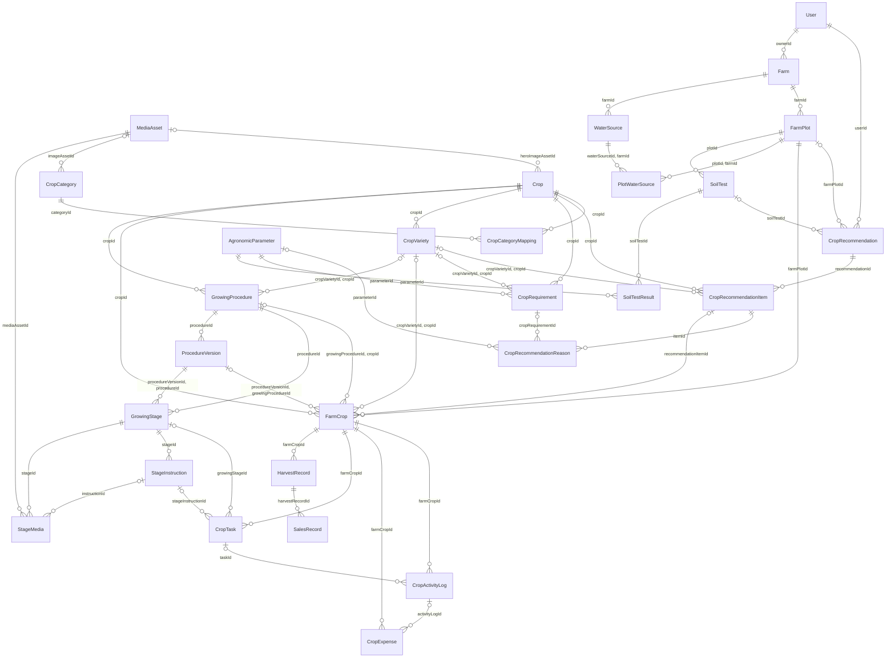

## MODULE 1 — User management (+ Language, shared with Module 6)

Schema file: `apps/api/prisma/schema/01_users.prisma` · Tables: `Language`, `User`, `Role`, `UserRole`, `ExpertProfile`, `UserFile`

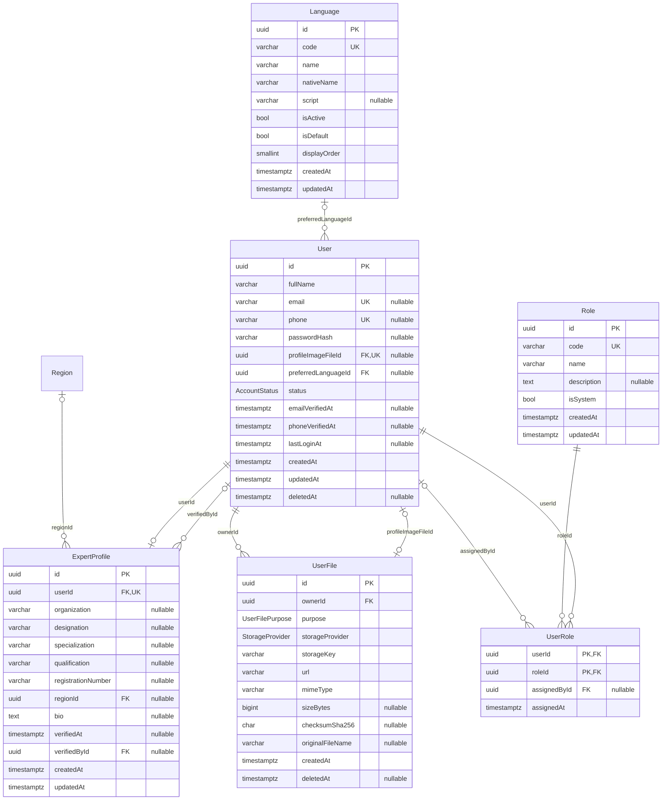

All foreign keys in this module

| Table | Column(s) | References | On delete |
|---|---|---|---|
| ExpertProfile | regionId | Region(id) | SET NULL |
| ExpertProfile | userId | User(id) | CASCADE |
| ExpertProfile | verifiedById | User(id) | SET NULL |
| User | preferredLanguageId | Language(id) | SET NULL |
| User | profileImageFileId | UserFile(id) | SET NULL |
| UserFile | ownerId | User(id) | CASCADE |
| UserRole | assignedById | User(id) | SET NULL |
| UserRole | roleId | Role(id) | RESTRICT |
| UserRole | userId | User(id) | CASCADE |

## Reference (lookup) data shared by all modules. Every list here is admin-managed data, not an enum.

Schema file: `apps/api/prisma/schema/02_reference.prisma` · Tables: `MeasurementUnit`, `Region`, `SoilType`, `Season`, `AgronomicParameter`, `WaterSourceType`, `StageType`, `CultivationMethod`

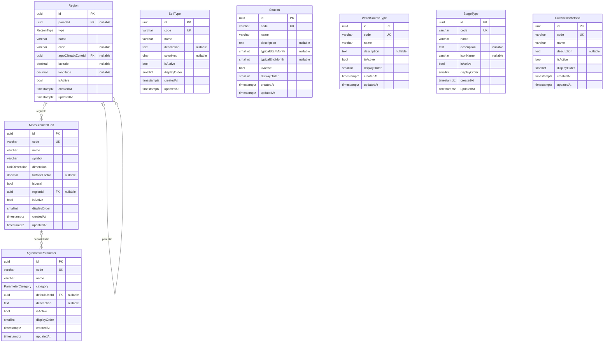

All foreign keys in this module

| Table | Column(s) | References | On delete |
|---|---|---|---|
| AgronomicParameter | defaultUnitId | MeasurementUnit(id) | RESTRICT |
| MeasurementUnit | regionId | Region(id) | SET NULL |
| Region | agroClimaticZoneId | Region(id) | SET NULL |
| Region | parentId | Region(id) | RESTRICT |

## MODULE 2 — Crop categories (dynamic, unlimited depth)

Schema file: `apps/api/prisma/schema/03_categories.prisma` · Tables: `CropCategory`, `CropCategoryMapping`

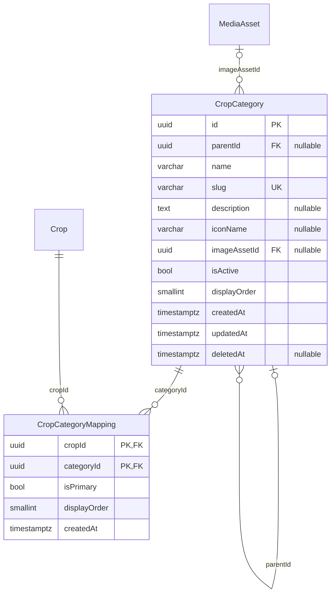

All foreign keys in this module

| Table | Column(s) | References | On delete |
|---|---|---|---|
| CropCategory | imageAssetId | MediaAsset(id) | SET NULL |
| CropCategory | parentId | CropCategory(id) | RESTRICT |
| CropCategoryMapping | categoryId | CropCategory(id) | RESTRICT |
| CropCategoryMapping | cropId | Crop(id) | CASCADE |

## MODULE 3 — Crops, varieties and crop requirements (verified agricultural knowledge)

Schema file: `apps/api/prisma/schema/04_crops.prisma` · Tables: `Crop`, `CropVariety`, `CropRequirement`, `CropSeasonMapping`, `CropSoilSuitability`, `CropRegionSuitability`, `CropEconomics`, `CropMedia`

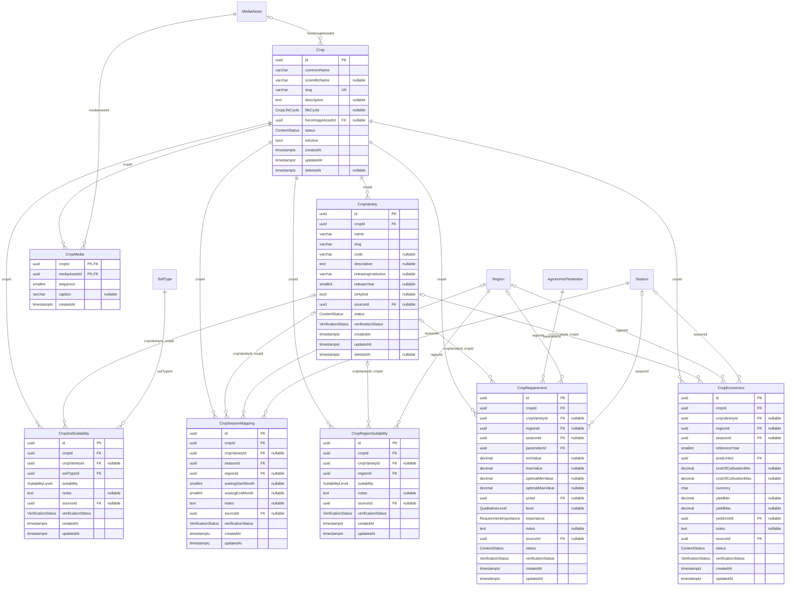

All foreign keys in this module

| Table | Column(s) | References | On delete |
|---|---|---|---|
| Crop | heroImageAssetId | MediaAsset(id) | SET NULL |
| CropEconomics | areaUnitId | MeasurementUnit(id) | RESTRICT |
| CropEconomics | cropId | Crop(id) | RESTRICT |
| CropEconomics | cropVarietyId, cropId | CropVariety(id, cropId) | RESTRICT |
| CropEconomics | regionId | Region(id) | RESTRICT |
| CropEconomics | seasonId | Season(id) | RESTRICT |
| CropEconomics | sourceId | ContentSource(id) | RESTRICT |
| CropEconomics | yieldUnitId | MeasurementUnit(id) | RESTRICT |
| CropMedia | cropId | Crop(id) | CASCADE |
| CropMedia | mediaAssetId | MediaAsset(id) | RESTRICT |
| CropRegionSuitability | cropId | Crop(id) | CASCADE |
| CropRegionSuitability | cropVarietyId, cropId | CropVariety(id, cropId) | RESTRICT |
| CropRegionSuitability | regionId | Region(id) | RESTRICT |
| CropRegionSuitability | sourceId | ContentSource(id) | RESTRICT |
| CropRequirement | cropId | Crop(id) | RESTRICT |
| CropRequirement | cropVarietyId, cropId | CropVariety(id, cropId) | RESTRICT |
| CropRequirement | parameterId | AgronomicParameter(id) | RESTRICT |
| CropRequirement | regionId | Region(id) | RESTRICT |
| CropRequirement | seasonId | Season(id) | RESTRICT |
| CropRequirement | sourceId | ContentSource(id) | RESTRICT |
| CropRequirement | unitId | MeasurementUnit(id) | RESTRICT |
| CropSeasonMapping | cropId | Crop(id) | CASCADE |
| CropSeasonMapping | cropVarietyId, cropId | CropVariety(id, cropId) | RESTRICT |
| CropSeasonMapping | regionId | Region(id) | RESTRICT |
| CropSeasonMapping | seasonId | Season(id) | RESTRICT |
| CropSeasonMapping | sourceId | ContentSource(id) | RESTRICT |
| CropSoilSuitability | cropId | Crop(id) | CASCADE |
| CropSoilSuitability | cropVarietyId, cropId | CropVariety(id, cropId) | RESTRICT |
| CropSoilSuitability | soilTypeId | SoilType(id) | RESTRICT |
| CropSoilSuitability | sourceId | ContentSource(id) | RESTRICT |
| CropVariety | cropId | Crop(id) | RESTRICT |
| CropVariety | sourceId | ContentSource(id) | RESTRICT |

## MODULE 4 — Growing procedures (versioned)

Schema file: `apps/api/prisma/schema/05_procedures.prisma` · Tables: `GrowingProcedure`, `ProcedureVersion`, `GrowingStage`, `StageInstruction`, `StageResource`, `StageCommonMistake`

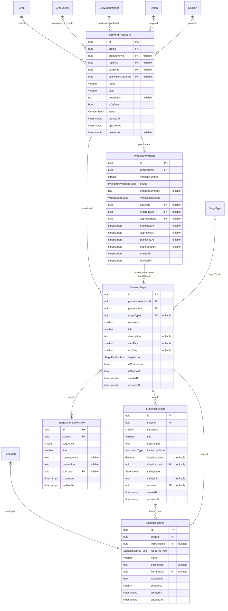

All foreign keys in this module

| Table | Column(s) | References | On delete |
|---|---|---|---|
| GrowingProcedure | cropId | Crop(id) | RESTRICT |
| GrowingProcedure | cropVarietyId, cropId | CropVariety(id, cropId) | RESTRICT |
| GrowingProcedure | cultivationMethodId | CultivationMethod(id) | RESTRICT |
| GrowingProcedure | regionId | Region(id) | RESTRICT |
| GrowingProcedure | seasonId | Season(id) | RESTRICT |
| GrowingStage | procedureId | GrowingProcedure(id) | CASCADE |
| GrowingStage | procedureVersionId, procedureId | ProcedureVersion(id, procedureId) | CASCADE |
| GrowingStage | stageTypeId | StageType(id) | RESTRICT |
| ProcedureVersion | approvedById | User(id) | SET NULL |
| ProcedureVersion | createdById | User(id) | SET NULL |
| ProcedureVersion | procedureId | GrowingProcedure(id) | CASCADE |
| ProcedureVersion | sourceId | ContentSource(id) | RESTRICT |
| StageCommonMistake | sourceId | ContentSource(id) | RESTRICT |
| StageCommonMistake | stageId | GrowingStage(id) | CASCADE |
| StageInstruction | durationUnitId | MeasurementUnit(id) | RESTRICT |
| StageInstruction | sourceId | ContentSource(id) | RESTRICT |
| StageInstruction | stageId | GrowingStage(id) | CASCADE |
| StageResource | farmInputId | FarmInput(id) | SET NULL |
| StageResource | instructionId | StageInstruction(id) | SET NULL |
| StageResource | stageId | GrowingStage(id) | CASCADE |

## MODULE 5 — Educational media, content sources and expert review

Schema file: `apps/api/prisma/schema/06_media_content.prisma` · Tables: `ContentSource`, `MediaAsset`, `StageMedia`, `ContentReview`

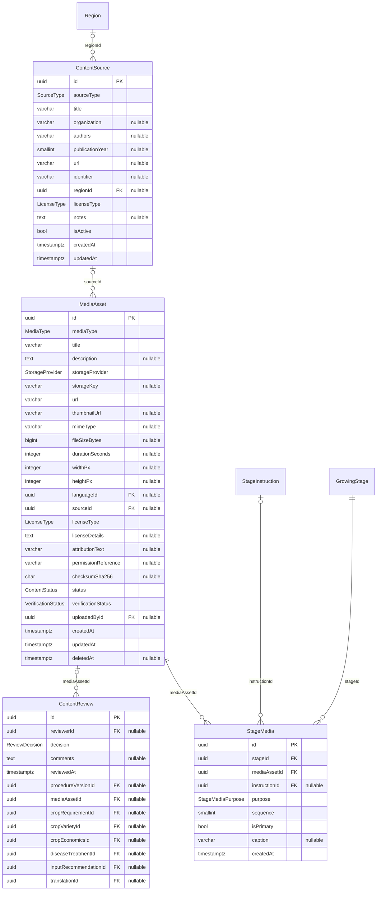

All foreign keys in this module

| Table | Column(s) | References | On delete |
|---|---|---|---|
| ContentReview | cropEconomicsId | CropEconomics(id) | CASCADE |
| ContentReview | cropRequirementId | CropRequirement(id) | CASCADE |
| ContentReview | cropVarietyId | CropVariety(id) | CASCADE |
| ContentReview | diseaseTreatmentId | DiseaseTreatment(id) | CASCADE |
| ContentReview | inputRecommendationId | InputRecommendation(id) | CASCADE |
| ContentReview | mediaAssetId | MediaAsset(id) | CASCADE |
| ContentReview | procedureVersionId | ProcedureVersion(id) | CASCADE |
| ContentReview | reviewerId | User(id) | SET NULL |
| ContentReview | translationId | Translation(id) | CASCADE |
| ContentSource | regionId | Region(id) | SET NULL |
| MediaAsset | languageId | Language(id) | RESTRICT |
| MediaAsset | sourceId | ContentSource(id) | RESTRICT |
| MediaAsset | uploadedById | User(id) | SET NULL |
| StageMedia | instructionId | StageInstruction(id) | SET NULL |
| StageMedia | mediaAssetId | MediaAsset(id) | RESTRICT |
| StageMedia | stageId | GrowingStage(id) | CASCADE |

## MODULE 6 — Language and translation

Schema file: `apps/api/prisma/schema/07_translation.prisma` · Tables: `Translation`

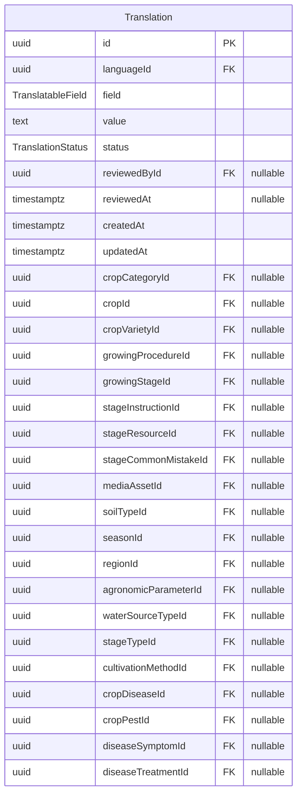

All foreign keys in this module

| Table | Column(s) | References | On delete |
|---|---|---|---|
| Translation | agronomicParameterId | AgronomicParameter(id) | CASCADE |
| Translation | cropCategoryId | CropCategory(id) | CASCADE |
| Translation | cropDiseaseId | CropDisease(id) | CASCADE |
| Translation | cropId | Crop(id) | CASCADE |
| Translation | cropPestId | CropPest(id) | CASCADE |
| Translation | cropVarietyId | CropVariety(id) | CASCADE |
| Translation | cultivationMethodId | CultivationMethod(id) | CASCADE |
| Translation | diseaseSymptomId | DiseaseSymptom(id) | CASCADE |
| Translation | diseaseTreatmentId | DiseaseTreatment(id) | CASCADE |
| Translation | growingProcedureId | GrowingProcedure(id) | CASCADE |
| Translation | growingStageId | GrowingStage(id) | CASCADE |
| Translation | languageId | Language(id) | RESTRICT |
| Translation | mediaAssetId | MediaAsset(id) | CASCADE |
| Translation | regionId | Region(id) | CASCADE |
| Translation | reviewedById | User(id) | SET NULL |
| Translation | seasonId | Season(id) | CASCADE |
| Translation | soilTypeId | SoilType(id) | CASCADE |
| Translation | stageCommonMistakeId | StageCommonMistake(id) | CASCADE |
| Translation | stageInstructionId | StageInstruction(id) | CASCADE |
| Translation | stageResourceId | StageResource(id) | CASCADE |
| Translation | stageTypeId | StageType(id) | CASCADE |
| Translation | waterSourceTypeId | WaterSourceType(id) | CASCADE |

## MODULE 7 — Farm management (farmer-owned data)

Schema file: `apps/api/prisma/schema/08_farms.prisma` · Tables: `Farm`, `FarmPlot`, `WaterSource`, `PlotWaterSource`, `SoilTest`, `SoilTestResult`

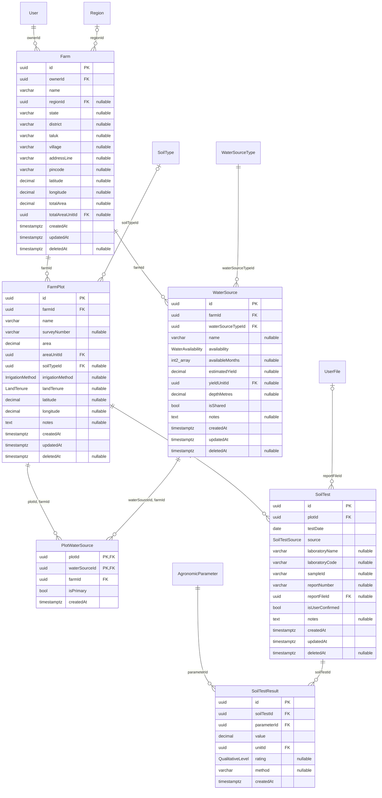

All foreign keys in this module

| Table | Column(s) | References | On delete |
|---|---|---|---|
| Farm | ownerId | User(id) | CASCADE |
| Farm | regionId | Region(id) | SET NULL |
| Farm | totalAreaUnitId | MeasurementUnit(id) | RESTRICT |
| FarmPlot | areaUnitId | MeasurementUnit(id) | RESTRICT |
| FarmPlot | farmId | Farm(id) | CASCADE |
| FarmPlot | soilTypeId | SoilType(id) | RESTRICT |
| PlotWaterSource | plotId, farmId | FarmPlot(id, farmId) | CASCADE |
| PlotWaterSource | waterSourceId, farmId | WaterSource(id, farmId) | CASCADE |
| SoilTest | plotId | FarmPlot(id) | CASCADE |
| SoilTest | reportFileId | UserFile(id) | SET NULL |
| SoilTestResult | parameterId | AgronomicParameter(id) | RESTRICT |
| SoilTestResult | soilTestId | SoilTest(id) | CASCADE |
| SoilTestResult | unitId | MeasurementUnit(id) | RESTRICT |
| WaterSource | farmId | Farm(id) | CASCADE |
| WaterSource | waterSourceTypeId | WaterSourceType(id) | RESTRICT |
| WaterSource | yieldUnitId | MeasurementUnit(id) | RESTRICT |

## MODULE 8 — Crop recommendations

Schema file: `apps/api/prisma/schema/09_recommendations.prisma` · Tables: `WeatherSnapshot`, `CropRecommendation`, `CropRecommendationWeather`, `CropRecommendationItem`, `CropRecommendationReason`

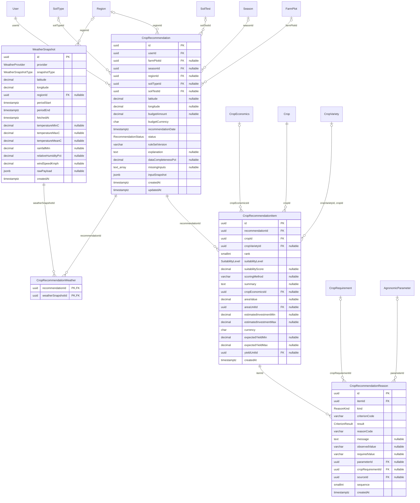

All foreign keys in this module

| Table | Column(s) | References | On delete |
|---|---|---|---|
| CropRecommendation | farmPlotId | FarmPlot(id) | SET NULL |
| CropRecommendation | regionId | Region(id) | SET NULL |
| CropRecommendation | seasonId | Season(id) | RESTRICT |
| CropRecommendation | soilTestId | SoilTest(id) | SET NULL |
| CropRecommendation | soilTypeId | SoilType(id) | RESTRICT |
| CropRecommendation | userId | User(id) | CASCADE |
| CropRecommendationItem | areaUnitId | MeasurementUnit(id) | RESTRICT |
| CropRecommendationItem | cropEconomicsId | CropEconomics(id) | RESTRICT |
| CropRecommendationItem | cropId | Crop(id) | RESTRICT |
| CropRecommendationItem | cropVarietyId, cropId | CropVariety(id, cropId) | RESTRICT |
| CropRecommendationItem | recommendationId | CropRecommendation(id) | CASCADE |
| CropRecommendationItem | yieldUnitId | MeasurementUnit(id) | RESTRICT |
| CropRecommendationReason | cropRequirementId | CropRequirement(id) | SET NULL |
| CropRecommendationReason | itemId | CropRecommendationItem(id) | CASCADE |
| CropRecommendationReason | parameterId | AgronomicParameter(id) | SET NULL |
| CropRecommendationReason | sourceId | ContentSource(id) | SET NULL |
| CropRecommendationWeather | recommendationId | CropRecommendation(id) | CASCADE |
| CropRecommendationWeather | weatherSnapshotId | WeatherSnapshot(id) | RESTRICT |
| WeatherSnapshot | regionId | Region(id) | SET NULL |

## MODULE 9 — Farmer crop lifecycle

Schema file: `apps/api/prisma/schema/10_lifecycle.prisma` · Tables: `FarmCrop`, `CropTask`, `TaskReminder`, `CropActivityLog`, `CropObservation`, `CropObservationFile`, `IrrigationLog`

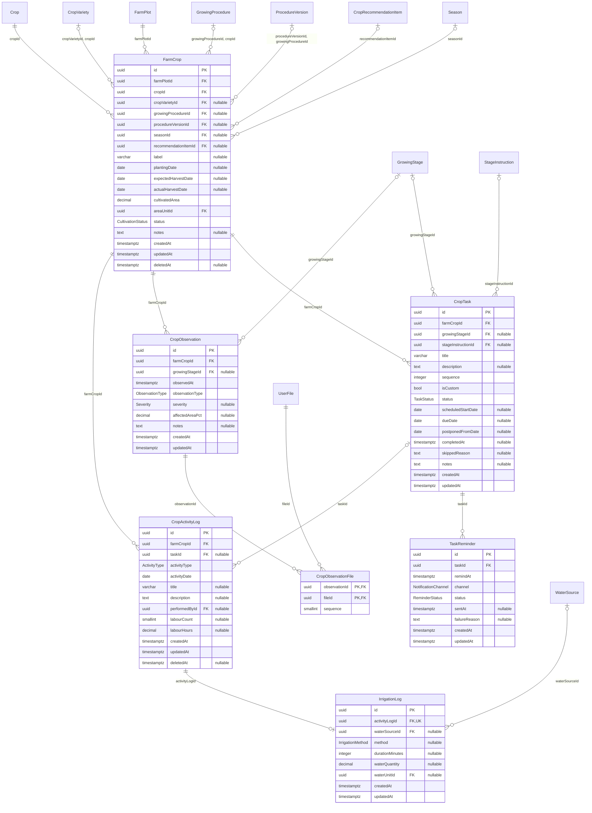

All foreign keys in this module

| Table | Column(s) | References | On delete |
|---|---|---|---|
| CropActivityLog | farmCropId | FarmCrop(id) | CASCADE |
| CropActivityLog | performedById | User(id) | SET NULL |
| CropActivityLog | taskId | CropTask(id) | SET NULL |
| CropObservation | farmCropId | FarmCrop(id) | CASCADE |
| CropObservation | growingStageId | GrowingStage(id) | RESTRICT |
| CropObservationFile | fileId | UserFile(id) | CASCADE |
| CropObservationFile | observationId | CropObservation(id) | CASCADE |
| CropTask | farmCropId | FarmCrop(id) | CASCADE |
| CropTask | growingStageId | GrowingStage(id) | RESTRICT |
| CropTask | stageInstructionId | StageInstruction(id) | RESTRICT |
| FarmCrop | areaUnitId | MeasurementUnit(id) | RESTRICT |
| FarmCrop | cropId | Crop(id) | RESTRICT |
| FarmCrop | cropVarietyId, cropId | CropVariety(id, cropId) | RESTRICT |
| FarmCrop | farmPlotId | FarmPlot(id) | CASCADE |
| FarmCrop | growingProcedureId, cropId | GrowingProcedure(id, cropId) | RESTRICT |
| FarmCrop | procedureVersionId, growingProcedureId | ProcedureVersion(id, procedureId) | RESTRICT |
| FarmCrop | recommendationItemId | CropRecommendationItem(id) | SET NULL |
| FarmCrop | seasonId | Season(id) | RESTRICT |
| IrrigationLog | activityLogId | CropActivityLog(id) | CASCADE |
| IrrigationLog | waterSourceId | WaterSource(id) | SET NULL |
| IrrigationLog | waterUnitId | MeasurementUnit(id) | RESTRICT |
| TaskReminder | taskId | CropTask(id) | CASCADE |

## MODULE 10 — Disease and pest management

Schema file: `apps/api/prisma/schema/11_pests_diseases.prisma` · Tables: `CropDisease`, `CropPest`, `CropDiseaseMapping`, `CropPestMapping`, `DiseaseSymptom`, `DiseaseSymptomMedia`, `DiseaseTreatment`, `CropDiagnosis`, `CropDiagnosisFile`, `DiagnosisAiCandidate`

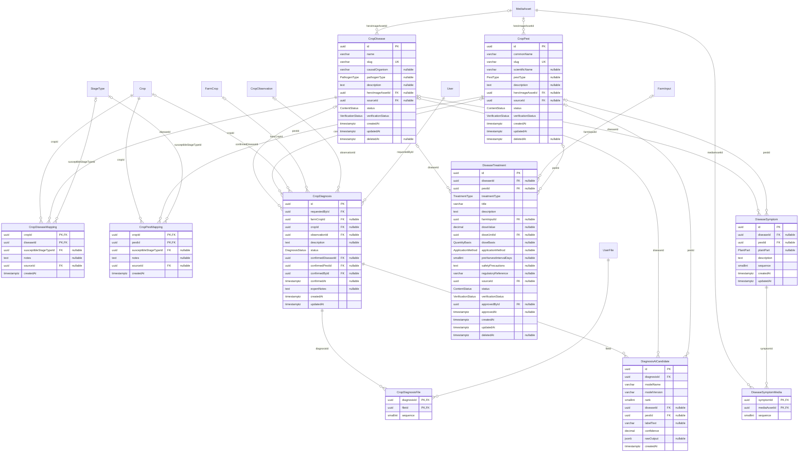

All foreign keys in this module

| Table | Column(s) | References | On delete |
|---|---|---|---|
| CropDiagnosis | confirmedById | User(id) | SET NULL |
| CropDiagnosis | confirmedDiseaseId | CropDisease(id) | SET NULL |
| CropDiagnosis | confirmedPestId | CropPest(id) | SET NULL |
| CropDiagnosis | cropId | Crop(id) | SET NULL |
| CropDiagnosis | farmCropId | FarmCrop(id) | SET NULL |
| CropDiagnosis | observationId | CropObservation(id) | SET NULL |
| CropDiagnosis | requestedById | User(id) | CASCADE |
| CropDiagnosisFile | diagnosisId | CropDiagnosis(id) | CASCADE |
| CropDiagnosisFile | fileId | UserFile(id) | CASCADE |
| CropDisease | heroImageAssetId | MediaAsset(id) | SET NULL |
| CropDisease | sourceId | ContentSource(id) | RESTRICT |
| CropDiseaseMapping | cropId | Crop(id) | CASCADE |
| CropDiseaseMapping | diseaseId | CropDisease(id) | CASCADE |
| CropDiseaseMapping | sourceId | ContentSource(id) | RESTRICT |
| CropDiseaseMapping | susceptibleStageTypeId | StageType(id) | SET NULL |
| CropPest | heroImageAssetId | MediaAsset(id) | SET NULL |
| CropPest | sourceId | ContentSource(id) | RESTRICT |
| CropPestMapping | cropId | Crop(id) | CASCADE |
| CropPestMapping | pestId | CropPest(id) | CASCADE |
| CropPestMapping | sourceId | ContentSource(id) | RESTRICT |
| CropPestMapping | susceptibleStageTypeId | StageType(id) | SET NULL |
| DiagnosisAiCandidate | diagnosisId | CropDiagnosis(id) | CASCADE |
| DiagnosisAiCandidate | diseaseId | CropDisease(id) | SET NULL |
| DiagnosisAiCandidate | pestId | CropPest(id) | SET NULL |
| DiseaseSymptom | diseaseId | CropDisease(id) | CASCADE |
| DiseaseSymptom | pestId | CropPest(id) | CASCADE |
| DiseaseSymptomMedia | mediaAssetId | MediaAsset(id) | RESTRICT |
| DiseaseSymptomMedia | symptomId | DiseaseSymptom(id) | CASCADE |
| DiseaseTreatment | approvedById | User(id) | SET NULL |
| DiseaseTreatment | diseaseId | CropDisease(id) | CASCADE |
| DiseaseTreatment | doseUnitId | MeasurementUnit(id) | RESTRICT |
| DiseaseTreatment | farmInputId | FarmInput(id) | SET NULL |
| DiseaseTreatment | pestId | CropPest(id) | CASCADE |
| DiseaseTreatment | sourceId | ContentSource(id) | RESTRICT |

## MODULE 11 — Agricultural inputs and expenses

Schema file: `apps/api/prisma/schema/12_inputs_expenses.prisma` · Tables: `FarmInput`, `InputRecommendation`, `InputPurchase`, `InputApplicationLog`, `CropExpense`

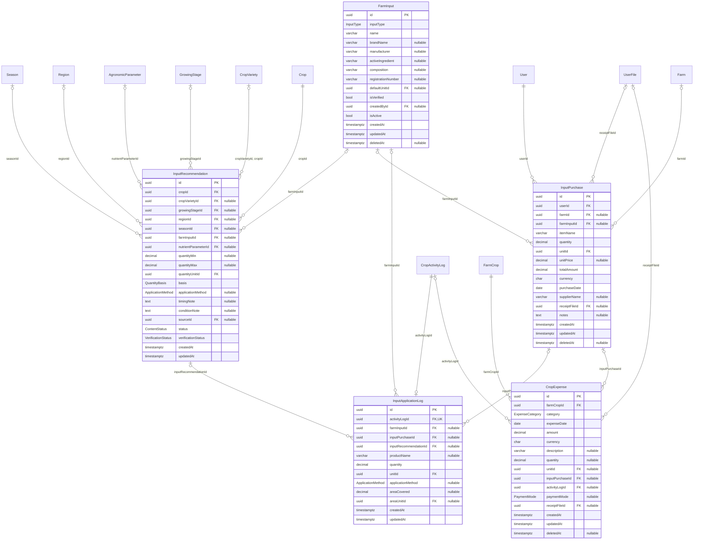

All foreign keys in this module

| Table | Column(s) | References | On delete |
|---|---|---|---|
| CropExpense | activityLogId | CropActivityLog(id) | SET NULL |
| CropExpense | farmCropId | FarmCrop(id) | CASCADE |
| CropExpense | inputPurchaseId | InputPurchase(id) | SET NULL |
| CropExpense | receiptFileId | UserFile(id) | SET NULL |
| CropExpense | unitId | MeasurementUnit(id) | RESTRICT |
| FarmInput | createdById | User(id) | SET NULL |
| FarmInput | defaultUnitId | MeasurementUnit(id) | RESTRICT |
| InputApplicationLog | activityLogId | CropActivityLog(id) | CASCADE |
| InputApplicationLog | areaUnitId | MeasurementUnit(id) | RESTRICT |
| InputApplicationLog | farmInputId | FarmInput(id) | SET NULL |
| InputApplicationLog | inputPurchaseId | InputPurchase(id) | SET NULL |
| InputApplicationLog | inputRecommendationId | InputRecommendation(id) | SET NULL |
| InputApplicationLog | unitId | MeasurementUnit(id) | RESTRICT |
| InputPurchase | farmId | Farm(id) | SET NULL |
| InputPurchase | farmInputId | FarmInput(id) | SET NULL |
| InputPurchase | receiptFileId | UserFile(id) | SET NULL |
| InputPurchase | unitId | MeasurementUnit(id) | RESTRICT |
| InputPurchase | userId | User(id) | CASCADE |
| InputRecommendation | cropId | Crop(id) | RESTRICT |
| InputRecommendation | cropVarietyId, cropId | CropVariety(id, cropId) | RESTRICT |
| InputRecommendation | farmInputId | FarmInput(id) | SET NULL |
| InputRecommendation | growingStageId | GrowingStage(id) | CASCADE |
| InputRecommendation | nutrientParameterId | AgronomicParameter(id) | RESTRICT |
| InputRecommendation | quantityUnitId | MeasurementUnit(id) | RESTRICT |
| InputRecommendation | regionId | Region(id) | RESTRICT |
| InputRecommendation | seasonId | Season(id) | RESTRICT |
| InputRecommendation | sourceId | ContentSource(id) | RESTRICT |

## MODULE 12 — Harvest and sales

Schema file: `apps/api/prisma/schema/13_harvest_sales.prisma` · Tables: `HarvestRecord`, `SalesRecord`

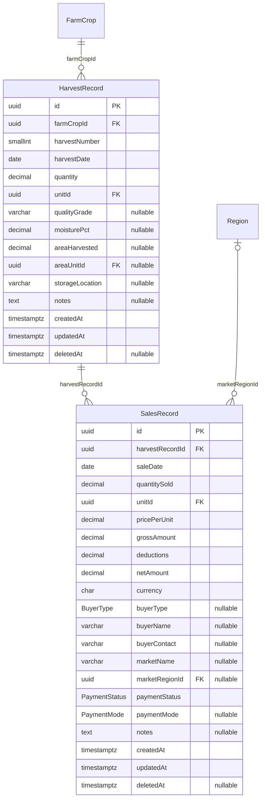

All foreign keys in this module

| Table | Column(s) | References | On delete |
|---|---|---|---|
| HarvestRecord | areaUnitId | MeasurementUnit(id) | RESTRICT |
| HarvestRecord | farmCropId | FarmCrop(id) | CASCADE |
| HarvestRecord | unitId | MeasurementUnit(id) | RESTRICT |
| SalesRecord | harvestRecordId | HarvestRecord(id) | CASCADE |
| SalesRecord | marketRegionId | Region(id) | SET NULL |
| SalesRecord | unitId | MeasurementUnit(id) | RESTRICT |

## MODULE 13 — Notifications and community (future features).

Schema file: `apps/api/prisma/schema/14_community.prisma` · Tables: `Notification`, `FarmerPost`, `PostMedia`, `PostComment`, `ExpertConsultation`

```mermaid
erDiagram
    Notification {
        uuid id PK
        uuid userId FK
        NotificationType type
        NotificationChannel channel
        varchar title
        text body
        NotificationStatus status
        uuid cropTaskId FK "nullable"
        uuid farmCropId FK "nullable"
        uuid recommendationId FK "nullable"
        uuid consultationId FK "nullable"
        timestamptz sentAt "nullable"
        timestamptz readAt "nullable"
        timestamptz createdAt
    }
    FarmerPost {
        uuid id PK
        uuid authorId FK
        uuid cropId FK "nullable"
        uuid languageId FK "nullable"
        varchar title "nullable"
        text body
        ModerationStatus status
        timestamptz createdAt
        timestamptz updatedAt
        timestamptz deletedAt "nullable"
    }
    PostMedia {
        uuid id PK
        uuid postId FK
        uuid fileId FK
        smallint sequence
        varchar caption "nullable"
        timestamptz createdAt
    }
    PostComment {
        uuid id PK
        uuid postId FK
        uuid authorId FK
        uuid parentCommentId FK "nullable"
        text body
        bool isExpertAnswer
        ModerationStatus status
        timestamptz createdAt
        timestamptz updatedAt
        timestamptz deletedAt "nullable"
    }
    ExpertConsultation {
        uuid id PK
        uuid farmerId FK
        uuid expertId FK "nullable"
        uuid farmCropId FK "nullable"
        uuid cropId FK "nullable"
        uuid diagnosisId FK "nullable"
        varchar subject
        text description
        ConsultationChannel channel
        ConsultationStatus status
        timestamptz requestedAt
        timestamptz assignedAt "nullable"
        timestamptz resolvedAt "nullable"
        text resolutionSummary "nullable"
        timestamptz createdAt
        timestamptz updatedAt
    }
    Crop |o--o{ ExpertConsultation : "cropId"
    CropDiagnosis |o--o{ ExpertConsultation : "diagnosisId"
    User |o--o{ ExpertConsultation : "expertId"
    FarmCrop |o--o{ ExpertConsultation : "farmCropId"
    User ||--o{ ExpertConsultation : "farmerId"
    User ||--o{ FarmerPost : "authorId"
    Crop |o--o{ FarmerPost : "cropId"
    ExpertConsultation |o--o{ Notification : "consultationId"
    CropTask |o--o{ Notification : "cropTaskId"
    FarmCrop |o--o{ Notification : "farmCropId"
    CropRecommendation |o--o{ Notification : "recommendationId"
    User ||--o{ Notification : "userId"
    User ||--o{ PostComment : "authorId"
    PostComment |o--o{ PostComment : "parentCommentId"
    FarmerPost ||--o{ PostComment : "postId"
    UserFile ||--o{ PostMedia : "fileId"
    FarmerPost ||--o{ PostMedia : "postId"
```

All foreign keys in this module

| Table | Column(s) | References | On delete |
|---|---|---|---|
| ExpertConsultation | cropId | Crop(id) | SET NULL |
| ExpertConsultation | diagnosisId | CropDiagnosis(id) | SET NULL |
| ExpertConsultation | expertId | User(id) | SET NULL |
| ExpertConsultation | farmCropId | FarmCrop(id) | SET NULL |
| ExpertConsultation | farmerId | User(id) | CASCADE |
| FarmerPost | authorId | User(id) | CASCADE |
| FarmerPost | cropId | Crop(id) | SET NULL |
| FarmerPost | languageId | Language(id) | SET NULL |
| Notification | consultationId | ExpertConsultation(id) | SET NULL |
| Notification | cropTaskId | CropTask(id) | SET NULL |
| Notification | farmCropId | FarmCrop(id) | SET NULL |
| Notification | recommendationId | CropRecommendation(id) | SET NULL |
| Notification | userId | User(id) | CASCADE |
| PostComment | authorId | User(id) | CASCADE |
| PostComment | parentCommentId | PostComment(id) | CASCADE |
| PostComment | postId | FarmerPost(id) | CASCADE |
| PostMedia | fileId | UserFile(id) | CASCADE |
| PostMedia | postId | FarmerPost(id) | CASCADE |

